# Modelo de Dados do SGA

Responsável: Guilherme. Base para a seção "Diagramas MER e Modelo Lógico Relacional" do relatório. O script que implementa este modelo é o [`database/01_ddl.sql`](../database/01_ddl.sql).

## MER (modelo conceitual)

### Entidades

| Entidade | O que representa | Identificador |
|----------|------------------|---------------|
| Usuário | Quem acessa o sistema, com perfil Secretário ou Coordenador | id_usuario |
| Curso | Curso de graduação da FBI, com turno e mensalidade | id_curso |
| Disciplina | Disciplina da grade de um curso, em um período | id_disciplina |
| Professor | Docente que leciona turmas | id_professor |
| Aluno | Estudante vinculado a um curso | id_aluno (RA é chave candidata) |
| Turma | Oferta de uma disciplina, por um professor, em um semestre | id_turma |
| Matrícula | Participação de um aluno em uma turma, com notas, faltas e situação | id_matricula |
| Log de nota | Registro de auditoria de cada alteração de nota | id_log |

### Relacionamentos

| Relacionamento | Entidades | Cardinalidade | Observação |
|----------------|-----------|---------------|------------|
| possui | Curso → Disciplina | 1:N | Toda disciplina pertence a um curso |
| tem | Curso → Aluno | 1:N | Todo aluno está em um curso |
| é pré-requisito de | Disciplina ↔ Disciplina | N:N | Autorrelacionamento, vira a tabela `pre_requisito` |
| é oferecida em | Disciplina → Turma | 1:N | Uma disciplina pode ter várias turmas, inclusive no mesmo semestre |
| leciona | Professor → Turma | 1:N | Cada turma tem um professor |
| cursa | Aluno ↔ Turma | N:N | Vira a entidade associativa Matrícula, que tem atributos próprios (notas, faltas, situação) |
| registra | Usuário → Matrícula | 1:N | Usuário que fez a matrícula ou o último lançamento de notas |
| gera | Matrícula → Log de nota | 1:N | Uma linha por campo de nota alterado (RN08) |
| altera | Usuário → Log de nota | 1:N | Quem fez a alteração auditada |

## Modelo lógico relacional

```mermaid
erDiagram
    curso ||--o{ disciplina : possui
    curso ||--o{ aluno : tem
    disciplina ||--o{ pre_requisito : "exige"
    disciplina ||--o{ pre_requisito : "é requisito de"
    disciplina ||--o{ turma : "é oferecida em"
    professor ||--o{ turma : leciona
    aluno ||--o{ matricula : faz
    turma ||--o{ matricula : recebe
    usuario ||--o{ matricula : registra
    matricula ||--o{ log_nota : gera
    usuario ||--o{ log_nota : altera

    usuario {
        int id_usuario PK
        varchar nome
        char cpf UK
        varchar email UK
        varchar login UK
        char senha_hash "SHA-256 hex"
        varchar perfil "Secretario | Coordenador"
    }
    curso {
        int id_curso PK
        varchar nome "UNIQUE com turno"
        int carga_horaria_total
        varchar turno "Matutino | Vespertino | Noturno"
        decimal valor_mensalidade
    }
    disciplina {
        int id_disciplina PK
        int id_curso FK
        varchar nome
        int carga_horaria
        tinyint periodo
    }
    pre_requisito {
        int id_disciplina PK, FK
        int id_disciplina_requisito PK, FK
    }
    professor {
        int id_professor PK
        varchar nome
        char cpf UK
        varchar email UK
        varchar titulacao
        date data_admissao
    }
    aluno {
        int id_aluno PK
        varchar ra UK
        varchar nome
        char cpf UK
        varchar email UK
        date data_nascimento
        int id_curso FK
        varchar status "Ativo | Trancado | Formado"
    }
    turma {
        int id_turma PK
        int id_disciplina FK
        int id_professor FK
        char semestre "AAAA.S"
        int vagas
        int total_aulas
        varchar status "Aberta | Encerrada"
    }
    matricula {
        int id_matricula PK
        int id_aluno FK "UNIQUE com id_turma"
        int id_turma FK
        date data_matricula
        decimal n1 "0 a 10"
        decimal n2 "0 a 10"
        decimal exame "0 a 10"
        int faltas
        decimal media_final
        varchar situacao
        int id_usuario FK
    }
    log_nota {
        int id_log PK
        int id_matricula FK
        varchar campo
        decimal valor_antigo
        decimal valor_novo
        int usuario FK
        datetime data_hora
    }
```

Notação textual (PK sublinhada no relatório, FK com seta):

- **usuario** (<u>id_usuario</u>, nome, cpf, email, login, senha_hash, perfil)
- **curso** (<u>id_curso</u>, nome, carga_horaria_total, turno, valor_mensalidade)
- **disciplina** (<u>id_disciplina</u>, id_curso → curso, nome, carga_horaria, periodo)
- **pre_requisito** (<u>id_disciplina</u> → disciplina, <u>id_disciplina_requisito</u> → disciplina)
- **professor** (<u>id_professor</u>, nome, cpf, email, titulacao, data_admissao)
- **aluno** (<u>id_aluno</u>, ra, nome, cpf, email, data_nascimento, id_curso → curso, status)
- **turma** (<u>id_turma</u>, id_disciplina → disciplina, id_professor → professor, semestre, vagas, total_aulas, status)
- **matricula** (<u>id_matricula</u>, id_aluno → aluno, id_turma → turma, data_matricula, n1, n2, exame, faltas, media_final, situacao, id_usuario → usuario)
- **log_nota** (<u>id_log</u>, id_matricula → matricula, campo, valor_antigo, valor_novo, usuario → usuario, data_hora)

## Restrições

| Tabela | UNIQUE | CHECK |
|--------|--------|-------|
| usuario | cpf, email, login | cpf com 11 dígitos; senha_hash com 64 caracteres hexadecimais minúsculos; perfil |
| curso | (nome, turno) | carga_horaria_total > 0; turno; valor_mensalidade ≥ 0 |
| disciplina | (id_curso, nome) | carga_horaria > 0; periodo de 1 a 12 |
| pre_requisito | (PK composta) | a disciplina não pode ser pré-requisito dela mesma |
| professor | cpf, email | cpf com 11 dígitos; titulacao: Graduado, Especialista, Mestre ou Doutor |
| aluno | ra, cpf, email | cpf com 11 dígitos; status |
| turma | | semestre no formato AAAA.1 ou AAAA.2; vagas > 0; total_aulas > 0; status |
| matricula | (id_aluno, id_turma) | n1, n2, exame e media_final de 0 a 10 (RN07); faltas ≥ 0; situacao |

Os CHECKs de texto comparam com `COLLATE utf8mb4_bin`, então só aceitam a grafia exata combinada pelo grupo (por exemplo, `'Em Exame'` passa e `'Em exame'` é recusado).

As FKs usam a ação padrão (RESTRICT): não dá para excluir um aluno, turma ou usuário que já tenha matrícula ou log. Por isso a `sp_excluir_aluno` deve avisar "aluno tem matrículas, tranque em vez de excluir".

## Colunas além do mínimo do enunciado

| Coluna | Motivo |
|--------|--------|
| `curso.valor_mensalidade` | O relatório de faturamento por curso do Coordenador precisa de um valor, e nenhuma tabela mínima tem |
| `turma.status` | A `sp_fechar_semestre` precisa marcar a turma como encerrada |

## Índices

Além dos índices criados pelas PKs e pelos UNIQUE (ra, cpf, email, login):

| Índice | Por quê |
|--------|---------|
| `idx_aluno_curso`, `idx_turma_disciplina`, `idx_turma_professor`, `idx_matricula_turma`, `idx_matricula_usuario`, `idx_pre_requisito_requisito`, `idx_log_nota_matricula`, `idx_log_nota_usuario` | FKs: joins das views e verificação das constraints |
| `idx_turma_semestre` | `sp_fechar_semestre` e `sp_historico_aluno` filtram e ordenam por semestre |
| `idx_aluno_nome` | Busca de aluno pelo nome na tela do Secretário |

As FKs `disciplina.id_curso`, `pre_requisito.id_disciplina` e `matricula.id_aluno` já são a primeira coluna de uma PK ou UNIQUE composta, então não precisam de índice próprio.

## Diagrama EER do Workbench (para o PDF)

1. Rode o `01_ddl.sql` no seu MySQL.
2. No Workbench: **Database → Reverse Engineer...**, escolha a conexão, marque o schema `sga_fbi` e avance até o fim.
3. Organize as tabelas e use **File → Export → Export as PNG...**.
4. Salve em `relatorio/img/eer_sga_fbi.png`.
